# Trạng thái: Keyboard Layer Editor, bản 0.1.0 (đêm 2026-10-31 sang 2026-11-01)

Nhánh `feat/initial-app` (chưa merge vào `main`, không có remote, chưa push). Bản giao việc: `docs/BRIEF.md`; kế hoạch
đã duyệt: `docs/PLAN.md` (bản HTML `docs/plan.html`); các quyết định phát sinh: `docs/DECISIONS.md` (D1-D19).

**Đêm nay không có lệnh ghi nào gửi xuống bàn phím thật.** Trên bàn phím thật chỉ chạy liệt kê thiết bị, đọc report
descriptor và phiên đọc trang 0x10 + 0x02 (sau khi kiểm FILCO Assist đã đóng), tổng 44 phiên đọc trang. Mọi luồng ghi
chạy trên thiết bị giả. Không chạy trình cập nhật firmware.

## 1. Tóm tắt

| Hạng mục trong bản giao việc | Trạng thái |
|---|---|
| Xem 4 layer, sửa ô loại 0-4, undo/redo, xem khác biệt, ghi + đọc lại | Xong; ghi + đọc lại đã chạy trên thiết bị giả qua đủ luồng an toàn và test E2E; **chưa ghi trên bàn phím thật** (checklist mục 9) |
| Sao lưu tự động trước khi ghi, sao lưu tay, khôi phục, xuất / nhập file | Xong (định dạng thư mục của `fnmap.py`, đọc được cả hai chiều) |
| Kiến trúc mở cho nhiều model (model là dữ liệu + schema + kiểm hợp lệ) | Xong; một model: M10SP US, mức `experimental` |
| An toàn: diff + xác nhận, sao lưu, đọc lại từng byte, chặn khi FILCO Assist chạy, journal khi ghi dở | Xong, mỗi điểm lỗi có test |
| Test nhiều tầng (codec, golden bytes, thiết bị giả, property, fixture thật, E2E, ảnh chuẩn, model) | Xong; giả lập firmware (M7): không làm, lý do ở mục 7 |
| Ngân sách hiệu năng có số đo | Đạt mọi ngân sách (mục 4) |
| Bộ cài Windows | Xong, 2,12 MB, cài theo người dùng, chưa ký số |
| Macro (loại 6, lệnh 0x15), loại 8-15 | Chưa làm theo phạm vi bản đầu; ô macro / loại khác hiển thị và được giữ nguyên từng byte |

## 2. Bộ cài

- File: `D:\AI\filco_configurator\target\release\bundle\nsis\Keyboard Layer Editor_0.1.0_x64-setup.exe`
- Kích thước: 2,12 MB (2 220 385 byte; ngân sách 6 MB)
- SHA-256: `5dc43f41fa897a25af646ea5f9f0de4b4732d027afc9d603e9f72679ab24477e` (cũng nằm trong file `.sha256` cạnh bộ cài)
- Cài cho người dùng hiện tại vào `%LOCALAPPDATA%\Keyboard Layer Editor`, không cần admin. `scripts/release.ps1
  -InstallTest` đã cài im lặng, kiểm file, gỡ im lặng: OK.
- Chưa ký số: SmartScreen sẽ cảnh báo; README hướng dẫn kiểm SHA-256 rồi *More info > Run anyway*.
- Bản này đọc bàn phím thật bằng khoảng chờ 15 ms (đo ở D11); ghi vẫn 100 ms như FILCO Assist.

## 3. Test đã chạy và kết quả (lần chạy cuối, 2026-11-01)

| Bộ test | Lệnh | Kết quả |
|---|---|---|
| Quy tắc văn bản (không em dash, fixture không có đường dẫn máy / tên người dùng) | `scripts/check.ps1` | đạt |
| `cargo fmt --check`, `clippy --all-targets -D warnings` (pedantic), cả bản `e2e-sim` | `scripts/check.ps1` | đạt, 0 cảnh báo |
| Test Rust (unit, tích hợp, property, golden, fixture thật, schema model) | `cargo test --workspace` | **102 đạt, 0 lỗi** (+1 test vét cạn chạy riêng ở chế độ release) |
| Codec ô vét cạn 2^32 giá trị (giải mã rồi mã hóa lại đúng từng byte) | `scripts/check.ps1` | đạt, 6,6 s |
| Golden bytes so với `fnmap.py`: đọc 4 trang thật, ghi 1 trang + đọc lại | `filco-sim/tests/golden.rs` | khớp từng byte 48 + 24 report |
| Thiết bị giả: mọi lỗi giao thức (ACK sai, checksum sai, I/O, rút cáp ở từng gói, flash hỏng) | `filco-sim/tests/faults.rs` | 15 đạt |
| Luồng ghi an toàn: mỗi điểm lỗi của PLAN mục 5 cho đúng trạng thái cuối | `filco-service/tests/write_flow.rs` | 13 đạt |
| Property: trang ngẫu nhiên qua dây, chuỗi sửa ngẫu nhiên + undo/redo, sao lưu và file xuất | `tests/properties.rs` (2 crate) | đạt |
| `cargo deny` (giấy phép, nguồn, advisory) | `check.ps1`, `release.ps1` | đạt |
| prettier, eslint, svelte-check, vitest (10 test) | `scripts/check.ps1` | đạt |
| E2E qua WebDriver trên bản `e2e-sim` (10 kịch bản người dùng) + 7 ảnh chuẩn so pixel | `scripts/e2e.ps1 -Runs 3` | **17/17 đạt cả 3 lần liên tiếp** |
| Benchmark | `cargo bench`, `tests/e2e/perf.mjs` | mục 4 |
| Bộ cài: kích thước, JS+CSS, cài / gỡ | `scripts/release.ps1 -InstallTest` | đạt |
| Tích hợp với bàn phím thật (chỉ đọc): bản phát hành tự đọc 4 layer | thủ công qua WebDriver | đúng: M10 = Fn, Alt trái = Alt, Space trái lớp 3 = Esc, P lớp 4 = Shift+Win+S, khớp cấu hình `Layer4Snip` |

Kịch bản E2E: đọc 4 layer; đổi layer bằng phím số, đi bằng mũi tên; sửa, hoàn tác, làm lại, bỏ hết; từ chối byte
macro; Hủy trong bảng khác biệt (Enter rơi vào Hủy) không ghi gì; ghi 2 layer, đọc lại từ bàn phím thấy đúng; ghi lỗi
ở layer thứ hai thì cả hai layer được khôi phục và thay đổi còn nguyên; FILCO Assist chạy thì nút Lưu và Ctrl+S bị
chặn; rút / cắm lại; rút cáp giữa lúc ghi thì lần cắm lại hiện journal, nạp bản sao lưu và ghi lại được.

Lỗi thật mà test tìm ra và đã sửa: bàn phím ngừng trả lời giữa lúc ghi làm ứng dụng hiện nhầm "chưa hỗ trợ" và mất hộp
thoại kết quả (D18); màn hình "chưa có bàn phím" nháy 300 ms lúc khởi động và gây test chập chờn 2/4 lần (D17); tổ hợp
3 modifier không đọc được trên keycap (D16); tiến trình GPU của WebView2 làm vượt ngân sách bộ nhớ (D13).

## 4. Hiệu năng so với ngân sách (PLAN mục 8)

Đo trên máy này, bản release (`e2e-sim` cho các số giao diện, vì nó chạy đúng mã giao diện và IPC của bản phát hành).

| Chỉ số | Ngân sách | Đo được | |
|---|---|---|---|
| Khởi động tới khung hình đầu (trung vị 10 lần, chạy thẳng file exe) | ≤ 400 ms | **317 ms** | đạt |
| trong đó: Tauri + WebView2 tới lúc trang bắt đầu | | 258 ms | |
| trong đó: phần của ứng dụng (trang tới khung hình đầu) | ≤ 100 ms | **53 ms** | đạt |
| Khởi động tới tương tác được (không thiết bị) | ≤ 600 ms | **327 ms** | đạt |
| Liệt kê thiết bị (criterion, máy thật, không gửi report) | ≤ 50 ms | **0,53 ms** (lần đầu nguội qua CLI: 2,2 ms) | đạt |
| Chi phí ứng dụng khi đọc 4 layer (criterion, thiết bị giả không chờ) | ≤ 5 ms | **3,8 µs** | đạt |
| Đọc 4 layer, khoảng chờ 100 ms (thiết bị giả có độ trễ thật, tới khi hiện trên màn hình) | ≤ 5,0 s | **4,83 s**; máy thật qua CLI 4,83 s | đạt |
| Đọc 4 layer, khoảng chờ 15 ms | ≤ 1,0 s | **0,75 s**; máy thật qua CLI 0,75 s | đạt |
| Bấm phím trên hình tới khi vẽ xong (DOM + layout, p95 trên 200 lần) | ≤ 16 ms | **0,9 ms** (tới khung hình kế: 17,8 ms, tức là ngay khung kế tiếp) | đạt |
| Đổi layer (p95, 200 lần) | ≤ 16 ms | **2,9 ms** (khung kế: 17,6 ms) | đạt |
| Gán hành động tới khi phím vẽ lại, gồm IPC sang Rust (p95, 100 lần) | ≤ 50 ms | **17,9 ms** | đạt |
| Bộ nhớ tiến trình Rust (sau đọc 4 layer + 500 thao tác) | ≤ 40 MB | **5,9 MB** | đạt |
| Bộ nhớ tổng gồm WebView2 (cùng lúc) | ≤ 220 MB | **217 MB** | đạt (sát; D13) |
| Bộ cài NSIS | ≤ 6 MB | **2,12 MB** | đạt |
| JS + CSS gzip (không tính font) | ≤ 80 KB | **39,8 KB** | đạt |

Ghi chú: "tới khung hình kế" luôn khoảng 16-18 ms vì phải chờ nhịp vẽ 60 Hz; con số đúng với ngân sách "một khung
hình" là thời gian xử lý (0,9 ms và 2,9 ms), tức là cập nhật luôn kịp khung hình ngay sau cú bấm. Bộ nhớ tổng tính mọi
tiến trình con của ứng dụng (WebView2: browser 38,3, renderer 123,6, GPU 26,9, utility 12,0 + 7,5, crashpad 2,6 MB).
Renderer tăng khoảng 8 MB mỗi 100 lần gán liên tục và trả lại một phần khi rảnh (heap JS ổn định 5-20 MB); với cách dùng
thật (vài chục lần gán) còn xa ngân sách.

## 5. Bàn phím thật đêm nay

| Việc | Lệnh gửi | Số phiên đọc trang |
|---|---|---|
| Liệt kê, mở quyền 0, đọc VID/PID/REV và caps (M3) | không gửi report | 0 |
| Đọc report descriptor của System Control (loại 4 là mặt nạ bit, D10) | không gửi report | 0 |
| `filco-cli read --compare`, khoảng chờ 100 ms: checksum đúng, SHA-256 khớp `configs/2026-10-31_Layer4Snip` | 0x10, 0x02 | 4 |
| `filco-cli measure-delays`: 50, 25, 15, 10 ms, mỗi mức 2 lần, không lỗi, giống từng byte (D11) | 0x10, 0x02 | 36 |
| Bản phát hành tự đọc khi mở (tích hợp cuối) | 0x10, 0x02 | 4 |

Mọi transport mở ở `ReadOnly`: gói nào không phải lệnh 0x10 / 0x02 bị từ chối trước khi tới `HidD_SetFeature` (có unit
test). Model M10SP US dùng khoảng chờ đọc 15 ms (mức nhỏ nhất qua hết là 10 ms, lấy mức kế trên làm biên); model khác
và mọi lần ghi giữ 100 ms.

## 6. Ảnh chụp mọi màn hình

Bộ đầy đủ (21 trạng thái, sáng và tối) trong `docs/screenshots/`, sinh bằng `node tests/e2e/screenshots.mjs` trên bàn
phím giả mang cấu hình thật của người dùng. Một số ảnh chính:

| Sáng | Tối |
|---|---|
| 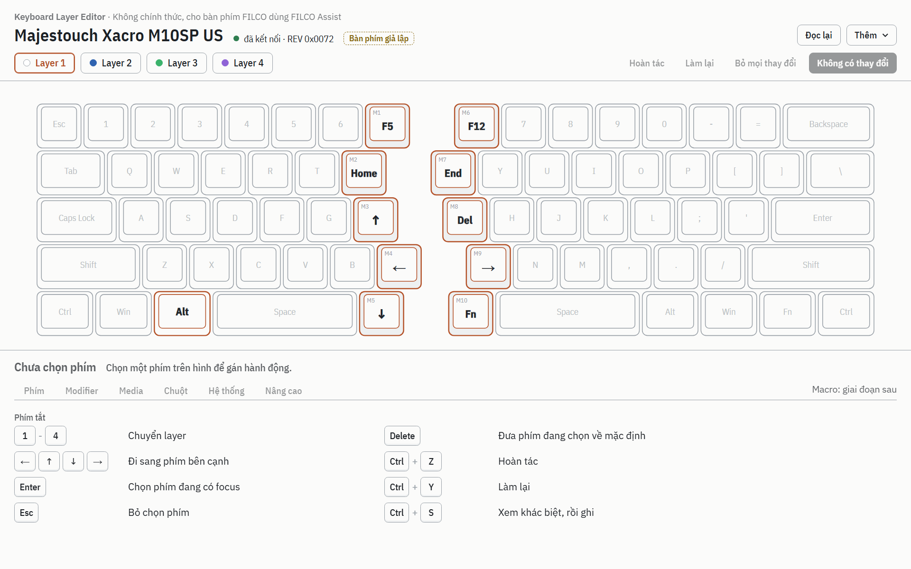 | 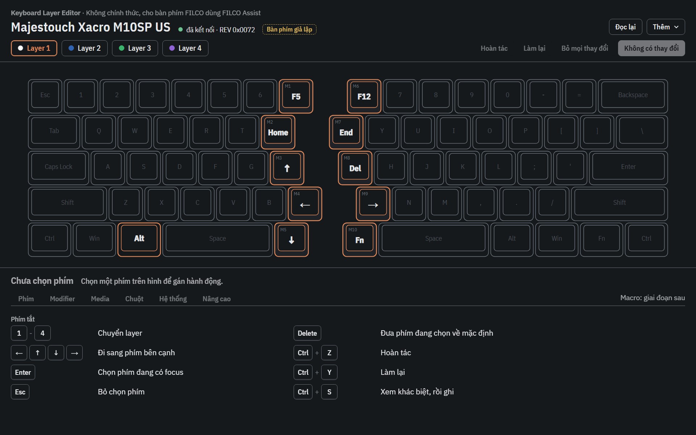 |
| 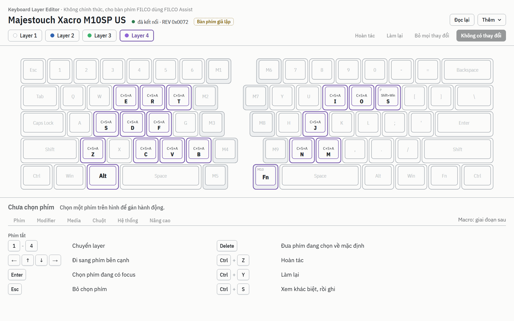 | 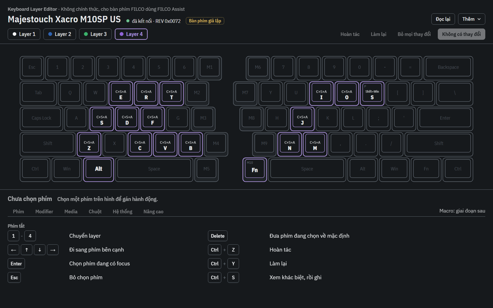 |
| 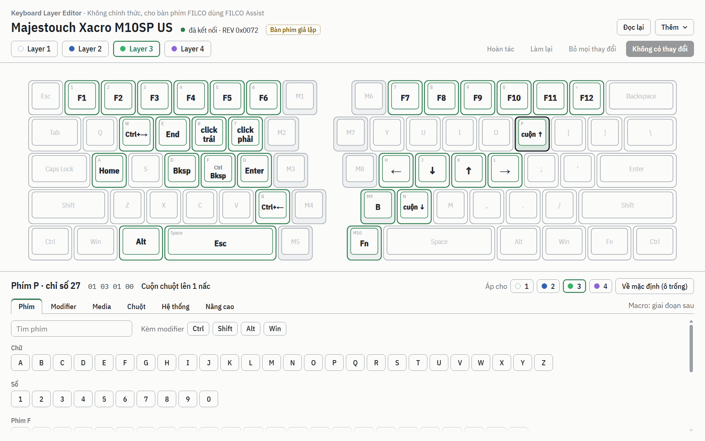 | 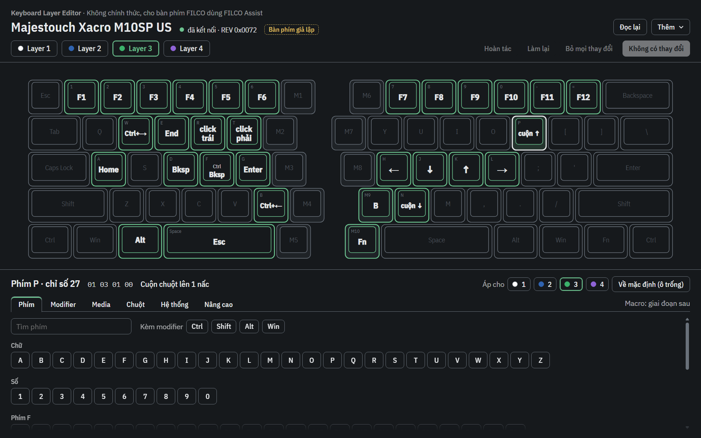 |
| 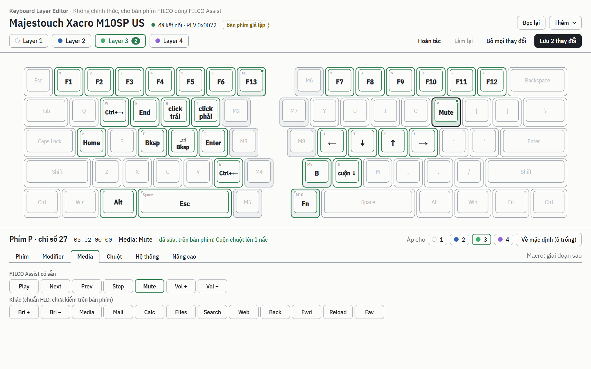 | 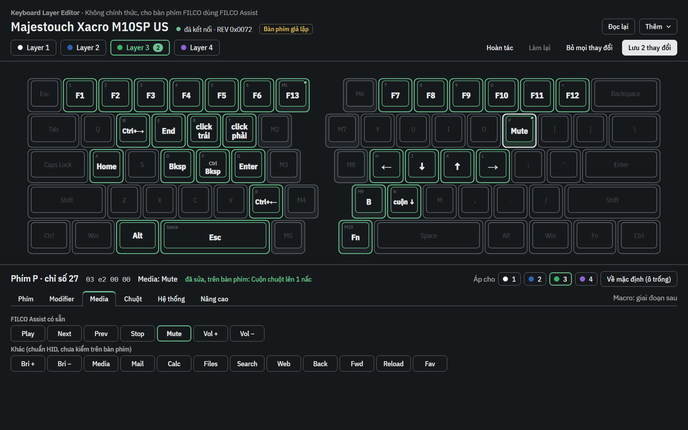 |
| 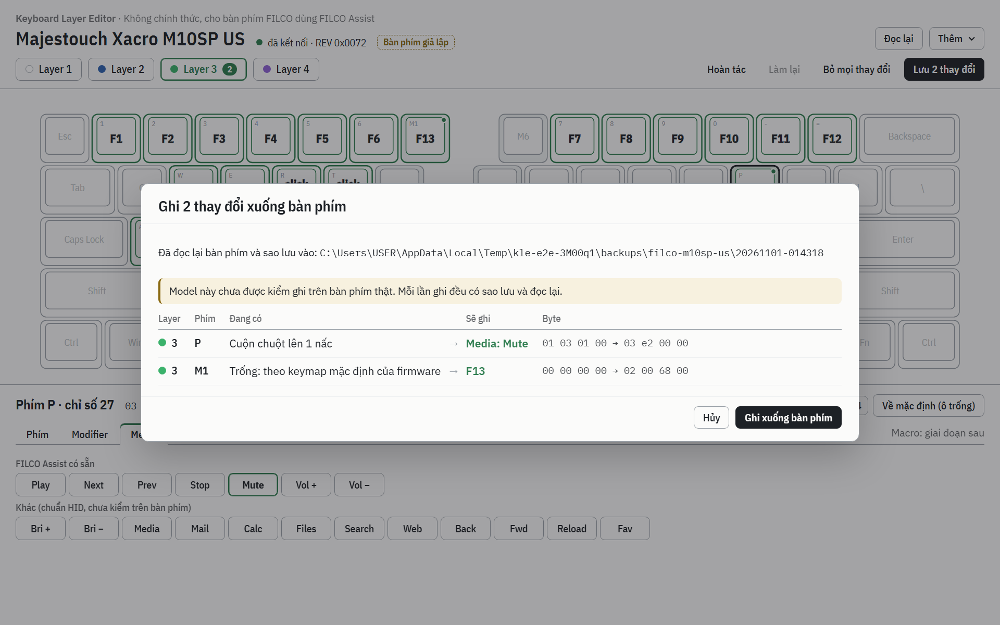 | 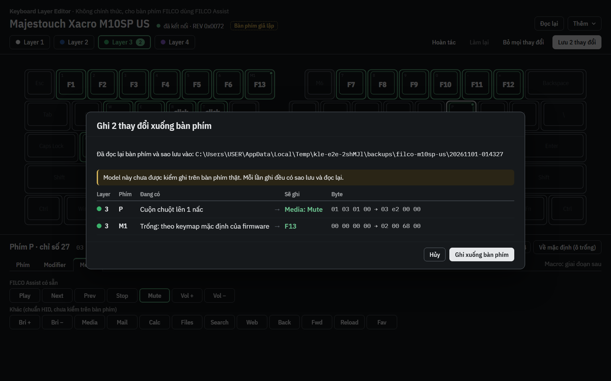 |
| 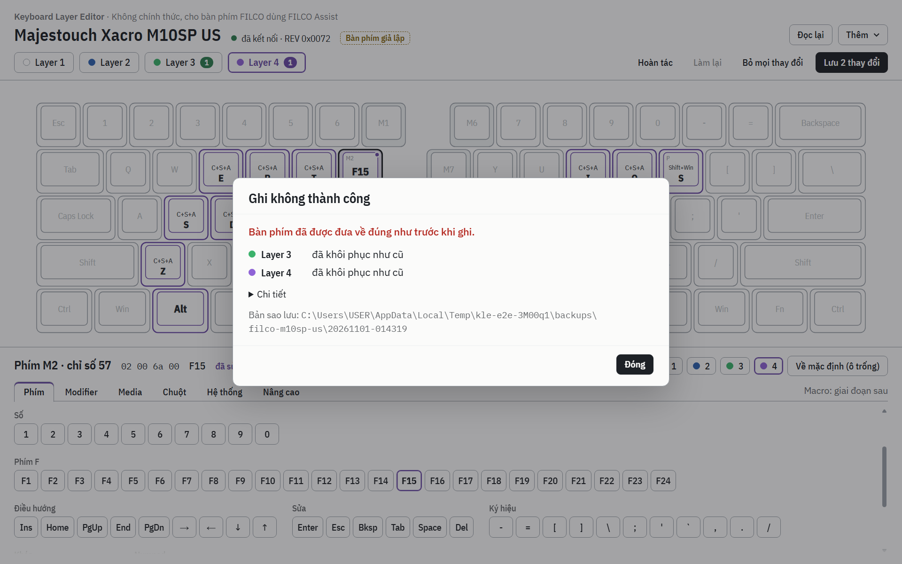 | 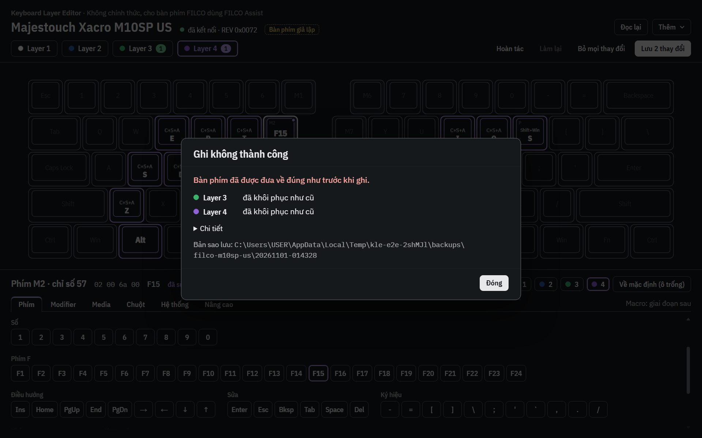 |
| 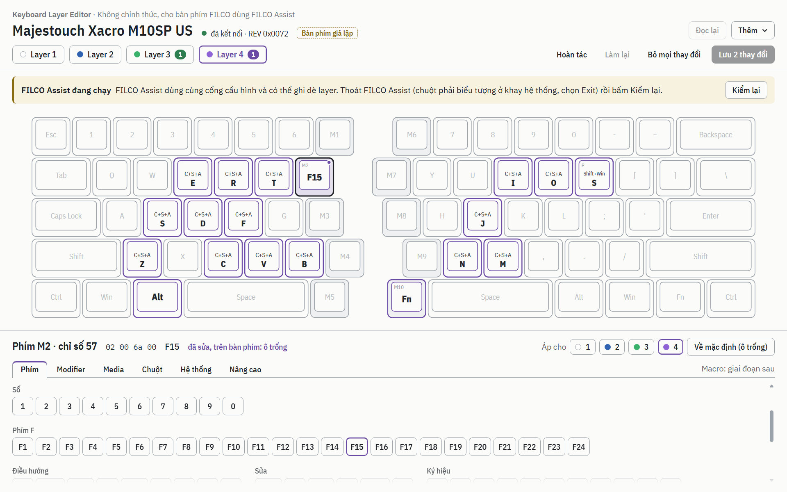 | 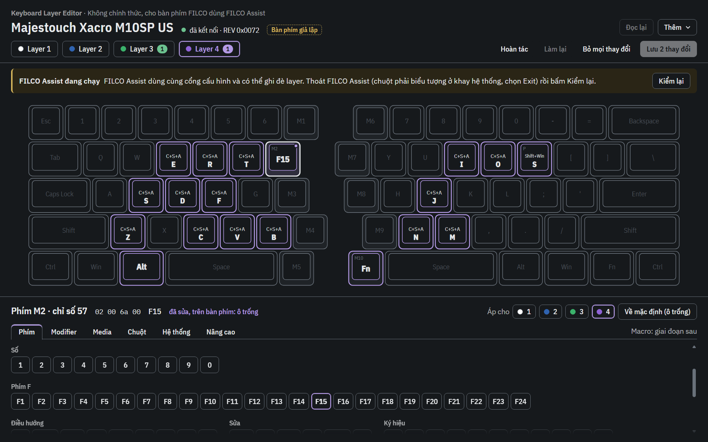 |
| 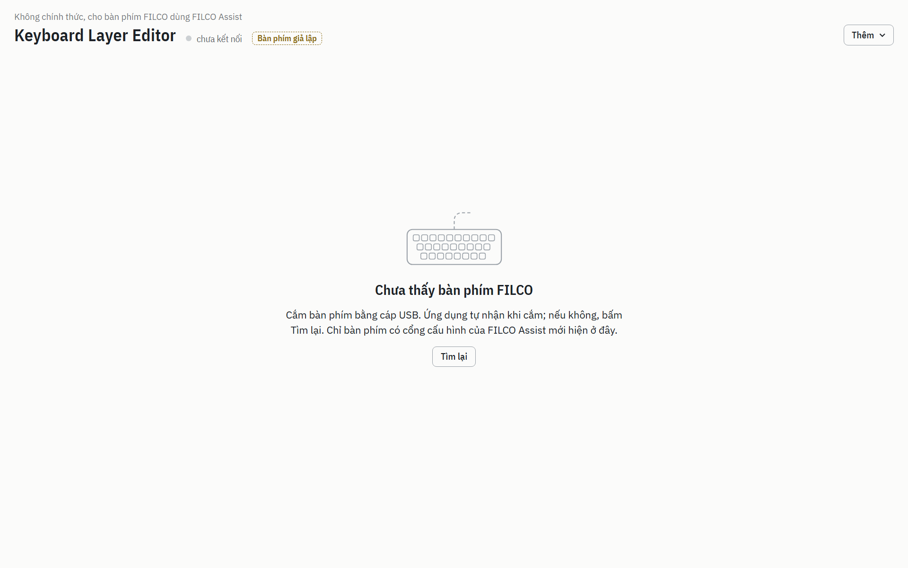 | 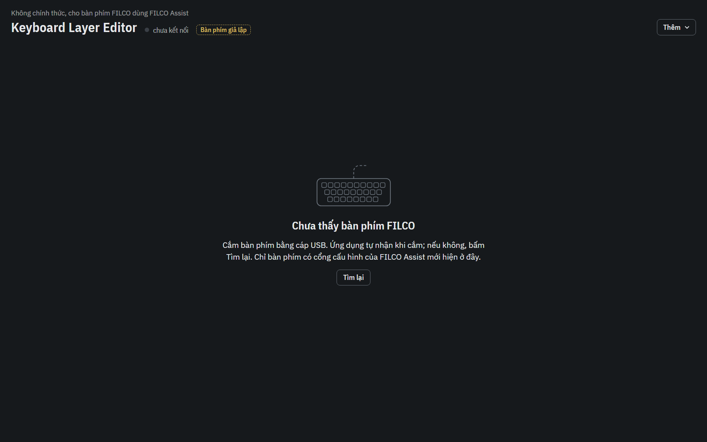 |

Các ảnh còn lại: `02-reading`, `04-layer3`, `06-tab-modifier|media|mouse|system|advanced`, `09-writing`,
`10-written`, `13-menu`, `14-backups`, `15-english`, `16-unplugged`, mỗi cái `-light` và `-dark`.

### Tự so với trang "M10SP layer setup" (`docs/layers.html` của repo phân tích)

| Khía cạnh | Trang M10SP layer setup | Ứng dụng | Ghi chú |
|---|---|---|---|
| Màu nền, mực, nét, mờ, `--soft` | `#fbfbfa`, `#1d2126`, `#9aa1a8`, `#b9bec3`, `#eef0f1` | giống | cùng token, cả bản tối |
| Màu nhấn layer 1/3/4 | `#b4532a`, `#2e7d4f`, `#6a4aa5` | giống | layer 2 dùng `#2f63b0` (trang chỉ dùng màu này cho chấm LED) |
| Chấm LED | trắng viền xám, xanh dương, xanh lá, tím | giống, lấy từ file model | |
| Font | IBM Plex Sans / Sans Condensed / Mono từ Google Fonts | cùng font, đóng gói cục bộ | chạy offline, CSP chặn mạng |
| Hình học phím | 64 px / đơn vị, outer lùi 2 bo 7, inner lùi 8/6 bo 5, khe 0,9 đơn vị giữa hai nửa | giống | dùng chung thông số (`ui/src/lib/keycap.ts`) |
| Phím M | nền `--soft` | giống | |
| Phím đã đổi | viền màu layer 1,6 px, chữ đậm có viền mảnh | giống, áp cho mọi ô không trống | |
| Chữ in trên phím | góc trên trái 8,5 px màu nét | giống | |
| Ô trống | chế độ "overlay": chữ in mờ | giống ở mọi layer | trang vẽ layer 1 ở chế độ "full" (chữ đậm); ứng dụng luôn coi ô trống là "theo keymap mặc định" nên vẽ mờ, kể cả layer 1 |
| Phím đang giữ để vào layer | nền mực đặc | không có | ứng dụng không biết phím nào là tap-hold (bản vá firmware), nên không vẽ |
| Trạng thái mới | | phím đang chọn (nền nhạt màu layer + viền mực), chấm thay đổi chưa ghi, viền nét đứt cho ô macro / loại khác | cần cho việc sửa |
| Tổ hợp dài | hai dòng do người viết tay | hai dòng tự động, modifier viết tắt khi dài (D16) | |
| Chế độ tối | theo hệ thống | theo hệ thống, có nút đổi trong menu | |
| Bố cục trang | trang tài liệu một cột, mỗi layer một hình | ứng dụng: thanh trên, tab layer, một hình bàn phím, bảng chọn hành động | khác có chủ ý |

Điểm đã soi và sửa qua ảnh: thiếu khoảng trắng sau dấu "·" ở dòng phụ đề, tổ hợp 3 modifier cỡ chữ 5 px, tiêu đề còn
tên model khi đã rút cáp, menu còn mở trong ảnh, nhóm phím "F" khó hiểu (nay "Phím F"), dòng "đã sửa" quá dài khi ô cũ
trống, màn hình "chưa có bàn phím" nháy lúc khởi động.

Sửa theo review giao diện vòng 1 (`docs/screenshots/` sinh lại toàn bộ, ảnh chuẩn E2E cập nhật):

| Điểm | Sửa |
|---|---|
| Lớp phủ sau hộp thoại gần như không thấy ở chế độ tối | Màu lớp phủ và bóng hộp thoại thành token theo chế độ (`--scrim`, `--dialog-shadow`): tối dùng đen 70 %. Áp cho mọi hộp thoại (khác biệt, kết quả ghi, sao lưu, journal) vì chúng cùng dùng `Modal`. Thêm ảnh chuẩn `diff-dark` để lỗi này không quay lại |
| Bảng khác biệt: cột "Đang có" quá rộng, mũi tên xa nội dung | Mọi cột co theo nội dung, cột byte nhận phần còn lại; mũi tên cách hai bên 10 px. Ô layer không còn `display: flex` trên chính `td` |
| Màn hình chưa chọn phím trống nửa dưới | Inspector giữ nguyên khung: tiêu đề "Chưa chọn phím", hàng tab (tắt), và bảng phím tắt hai cột (chọn phím bên trái; sửa và lưu bên phải) vẽ bằng keycap nhỏ |
| Soi lại các ảnh khác | Đường dẫn sao lưu chỉ xuống dòng sau dấu `\` (trước đó gãy giữa timestamp hoặc giữa "filco-m10sp"); vùng cuộn của inspector mờ dần ở mép dưới thay vì cắt ngang một hàng nút; hai nút ở chân hộp thoại sao lưu có viền để thẳng lề với nội dung; bóng menu "Thêm" thấy được ở chế độ tối; màn hình "chưa có bàn phím" canh giữa theo chiều dọc (lưới gốc có một hàng thừa) và đoạn chữ xuống dòng cân |

Đo lại sau khi sửa: bộ nhớ tổng 217 MB (trước 207 MB; renderer +5 MB, GPU +5 MB), vẫn dưới 220 MB nhưng sát; script
đo cũng được sửa để không đếm nhầm tiến trình lạ có PID cha bị tái dùng (lần đo đầu có một `AutoHotkey64.exe` 3 MB).

## 7. Còn lại và giới hạn

- **Ghi trên bàn phím thật chưa kiểm** (cố ý, theo bản giao việc): checklist mục 9. Sau khi đạt, đổi `support` thành
  `verified` trong `tools/gen_m10sp_model.py`, sinh lại `models/m10sp-us.json` (D8).
- **M7, giả lập firmware thật cho HID: không làm.** `emu.py` của repo phân tích chạy vòng lặp chính và ngắt quét phím,
  nhưng không mô phỏng khối USB của SN32F24xB (thanh ghi endpoint, SETUP/feature report, ngắt USB) và không có đường
  ghi flash IAP. Làm cho feature report 0x10/0x11/0x02 chạy qua firmware thật cần viết mô hình thiết bị USB của chip và
  IAP từ đầu, quá giới hạn 2 giờ của mốc; và vì repo này không được chép firmware, cầu nối chỉ có thể nạp ảnh từ repo
  phân tích lúc chạy. Thay vào đó: golden bytes từ `fnmap.py` (đã chạy nhiều lần trên chính bàn phím này) + thiết bị
  giả theo hành vi đó + đo trên máy thật. Rủi ro còn lại là firmware phản ứng khác `fnmap.py` ở trường hợp lỗi (ví dụ
  rút cáp giữa phiên ghi); checklist bước 7 kiểm điều này.
- Macro (loại 6, lệnh 0x15), loại 5, 7, 8-15, Game Mode, đồng bộ profile FILCO Assist: chưa làm (phạm vi bản đầu);
  ô các loại này hiển thị và được giữ nguyên.
- Một model (M10SP US). Ba model FILCO Assist khác (F67 M3A US, F70 M3A JP, F76 M10SP JP) được nhận ra và báo "chưa
  hỗ trợ".
- Không tự kiểm khi máy ngủ / thức giữa lúc ghi ngoài trường hợp rút cáp (journal xử lý cả hai giống nhau).
- `npm audit`: một cảnh báo mức thấp chỉ lúc build (D4).
- Ảnh chuẩn so pixel phụ thuộc máy (DPI 150 %, font rendering); trên máy khác cần sinh lại (`UPDATE_BASELINE=1`).

## 8. Người dùng cần chọn

1. **Tên sản phẩm**: đang là "Keyboard Layer Editor" (D6). Đổi ở `productName` / `title` trong
   `src-tauri/tauri.conf.json` và `PRODUCT_NAME` trong `ui/src/lib/i18n.ts`.
2. **Giấy phép** trước khi chia sẻ: chưa có file LICENSE. Phụ thuộc Rust là MIT / Apache-2.0 / BSD-3 / Zlib / Unicode /
   CC0 và MPL-2.0 (của Tauri), font IBM Plex là OFL (D19); MIT hoặc Apache-2.0 đều hợp.
3. **Alt phải là chỉ số 78 hay 87**: model để 78, gắn `unverified` (checklist bước 2).
4. Sau checklist: cho model lên `verified` hay giữ `experimental`.
5. Có ký số bộ cài hay không (cần chứng chỉ code signing).

## 9. Checklist test thủ công có ghi (sáng mai)

Chuẩn bị (làm một lần):

- Thoát FILCO Assist (chuột phải biểu tượng khay, *Exit*); kiểm `Get-Process FilcoAssist*` không ra gì.
- Cài bộ cài ở mục 2 (kiểm SHA-256 trước). Mở ứng dụng.
- Đường lui cho mọi bước: trong repo phân tích,
  `.venv\Scripts\python -I firmware\tools\fnmap.py restore firmware\configs\2026-10-31_Layer4Snip` đưa cả 4 layer về
  cấu hình hiện tại. Hoặc trong ứng dụng: *Thêm > Khôi phục từ bản sao lưu*, chọn bản "trước khi ghi" mới nhất, Lưu.
- Mỗi lần ghi, ứng dụng để bản sao lưu ở `%LOCALAPPDATA%\FilcoConfigurator\backups\filco-m10sp-us\`.

| # | Làm | Mong đợi | Nếu sai |
|---|---|---|---|
| 1 | Mở ứng dụng | Tự đọc 4 layer trong khoảng 1 giây; hình khớp `SETUP.md` / trang M10SP layer setup: layer 1 M1-M10, Caps, hai Space; layer 3 điều hướng; layer 4 C+S+A + chữ, P = Shift+Win+S | Chụp màn hình; *Thêm > Mở thư mục sao lưu* không cần; báo lại |
| 2 | Layer 1, bấm phím Alt phải trên hình | Inspector ghi "chỉ số 78". Không ghi gì. Nếu muốn kiểm: gán F13 cho Alt phải ở layer 3, Lưu, gõ thử Space trái + Alt phải trong một ô gõ thử phím (ví dụ trang keyboard tester); ra F13 là 78 đúng; rồi Hoàn tác + Lưu | Không ra F13: báo, model sẽ đổi sang 87 |
| 3 | Layer 3, chọn M1, tab Phím, chọn F13, **Lưu 1 thay đổi** | Bảng khác biệt: 1 dòng `layer 3, M1, Trống -> F13, 00 00 00 00 -> 02 00 68 00`, có đường dẫn sao lưu; bấm **Ghi xuống bàn phím** | |
| 3a | Sau khi ghi | Hộp "Đã ghi xong", layer 3 "đã ghi, đọc lại khớp"; có thư mục sao lưu mới; *Đọc lại* vẫn thấy F13 ở M1 | Ghi lỗi: đọc hộp kết quả, chụp, khôi phục bằng `fnmap.py restore` |
| 3b | Giữ Space trái, bấm M1 | Ra F13 (thấy được trong trang kiểm phím) | |
| 4 | *Thêm > Khôi phục từ bản sao lưu*, chọn bản "trước khi ghi" mới nhất, Lưu, Ghi | Diff 1 dòng ngược lại; sau ghi, trong PowerShell so SHA-256 bốn file của một bản *Sao lưu ngay* mới với `configs\2026-10-31_Layer4Snip\manifest.json` | Khác: `fnmap.py restore` |
| 5 | Layer 3: gán **Media > Mute** cho M2, **Chuột > Bấm nút Trái** cho M3, **Phím** Win+Shift+S (bật Shift, Win rồi chọn S) cho M4, **Hệ thống > Sleep** cho M5 (bước này làm máy ngủ: chỉ thử nếu muốn). Lưu một lần (diff 3-4 dòng), Ghi | Gõ thử từng phím khi giữ Space trái: tắt tiếng, click trái, công cụ chụp màn hình, máy ngủ | Phím không tác dụng: ghi lại loại nào; rồi Khôi phục như bước 4 |
| 6 | Mở FILCO Assist | Ứng dụng hiện dải vàng "FILCO Assist đang chạy", nút Lưu và Ctrl+S không làm gì; thoát FILCO Assist, bấm Kiểm lại thì hết | |
| 7 | (Tùy chọn, có rủi ro nhỏ) Sửa một ô ở layer 3, Lưu, bấm Ghi rồi rút cáp ngay | Hộp kết quả báo layer "không rõ (mất kết nối)" hoặc "đã ghi"; cắm lại: dải đỏ "Lần ghi trước chưa xong" ghi trạng thái từng layer; bấm "Nạp bản sao lưu để khôi phục", Lưu, Ghi | Bàn phím lạ: `fnmap.py restore firmware\configs\2026-10-31_Layer4Snip` |
| 8 | *Thêm > Xuất file layer*, rồi *Nhập file layer* chính file đó | Không có thay đổi nào (nút Lưu ghi "Không có thay đổi") | |
| 9 | Chuyển tiếng Anh / tối trong menu Thêm | Mọi chữ đổi theo; hình vẫn rõ ở chế độ tối | |
| 10 | Kết thúc | Bàn phím ở đúng `Layer4Snip` (so như bước 4). Nếu mọi bước đạt: đổi model sang `verified` (D8) | |

## 10. Mốc và commit

| Mốc | Commit |
|---|---|
| M0 khung workspace, Tauri + Svelte, NSIS, `check.ps1` | `d9031fb` |
| M1 `filco-core` | `368c43f` |
| M2 `filco-protocol`, `filco-sim`, golden từ `fnmap.py` | `59d13b0` |
| M3 HID Windows + CLI, kiểm trên máy thật (chỉ đọc) | `8557147` |
| M4 `filco-service`: phiên sửa, sao lưu, journal, ghi an toàn | `f7dab43` |
| M5 lớp Tauri + giao diện | `8b5f513`, `00b1c8c` |
| M6 E2E, hiệu năng, ảnh chuẩn, bộ cài | `9d4410a`, `4304dae` |
| M8 property test, `cargo deny`, README, DECISIONS, STATUS, ảnh chụp | `3897de2`, `fe13a37` |
| Sửa theo review implement vòng 1 | commit cuối |
| M7 giả lập firmware | không làm (mục 7) |
